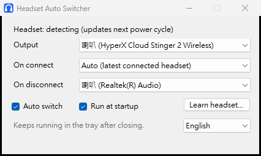

# Headset Auto Switcher

[繁體中文](README.zh-TW.md)

A small Windows tray app that moves your sound to the right device: to your headset when it connects, and back to your speakers when it disconnects. You can also switch by hand at any time, even with several headsets connected.



## Features

- Switches output automatically when a headset connects or disconnects
- Manual switching from the window or the tray menu, including devices that aren't connected
- Picking a disconnected Bluetooth headset asks Windows to reconnect it
- Learn mode (experimental) teaches the app a wireless headset that uses a USB receiver
- English and Traditional Chinese, following your Windows language by default
- Optional start with Windows

## What works with what

| Headset type | Manual switching | Automatic switching |
| --- | --- | --- |
| Bluetooth | Yes | Yes |
| HyperX Cloud Stinger 2 Wireless (USB receiver) | Yes | Yes, built in |
| Other USB receiver headsets | Should work, untested | Try Learn mode |
| Wired | Yes | Try Learn mode |

Tested on Windows 11 with HyperX Cloud Stinger 2 Wireless, REDMI Buds 8 Lite, and one wired and Bluetooth setup on a second PC. Other headsets haven't been tested yet, so reports are welcome.

## Install

1. Download `BtAudioSwitcher.exe` from [Releases](../../releases).
2. Put it somewhere permanent and run it. There is no installer.
3. Check **On disconnect** and pick your speakers.

It needs .NET Framework 4.8, which current Windows 10 and 11 already include.

### Windows security warnings

The app is not code-signed yet, so Windows may warn you:

- **SmartScreen** may show a blue "Windows protected your PC" window. You can choose **More info**, then **Run anyway**, if you trust the download.
- **Smart App Control**, where it is on, blocks unsigned apps outright. There is no per-app exception. Until the app is signed, it won't run on those PCs.

You can read the source and build it yourself, as described below.

## Using Learn mode

Learn mode finds out how your headset reports being turned on and off.

1. Press **Learn headset…** and pick the headset.
2. Leave it alone for 5 seconds.
3. Turn it off (or unplug it), then press **Next**.
4. Turn it on (or plug it in), then press **Finish**.

It only reads signals from the device you picked. It never sends commands to it. It works when the receiver reports on/off by itself, or when Windows sees the connection change. If neither happens, it says so, and manual switching still works. **Clear learned** removes everything it has learned.

## Known limits

- If a receiver headset is already on when the app starts, the app doesn't know until you turn the headset off and on once.
- Switching uses `IPolicyConfig`, an undocumented Windows interface that a future update could change.
- The log file is in Chinese only.

The log is at `%LOCALAPPDATA%\BluetoothAudioSwitcher\log.txt`. Settings are in `HKCU\Software\BluetoothAudioSwitcher`.

## Build from source

No extra tools are needed. `build.bat` uses the C# compiler that comes with Windows:

```bash
build.bat
```

`make-icon.ps1` regenerates `app.ico`. To sign the build, set `SIGN_THUMBPRINT` to your certificate's thumbprint before running `build.bat`.

## Reporting a headset

Open an issue with your headset model, whether it uses Bluetooth, a USB receiver or a cable, and whether Learn mode worked.

## License

[MIT](LICENSE)

This project isn't affiliated with or endorsed by HP, HyperX, Xiaomi or Microsoft. Product names belong to their owners.
