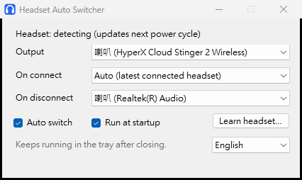

# 耳機自動切換

[English](README.md)

一個常駐在 Windows 系統匣的小工具：耳機連上時，聲音自動切到耳機；斷線時，自動切回喇叭。同時連著好幾副耳機時，也可以隨時手動切換。



## 功能

- 耳機連線或斷線時自動切換輸出
- 可從視窗或系統匣選單手動切換，未連線的裝置也會列出
- 選擇未連線的藍芽耳機時，會要求 Windows 重新連線
- 學習模式（實驗功能）：讓程式認識使用 USB 接收器的無線耳機
- 支援繁體中文和英文，預設跟著 Windows 語言
- 可選擇開機自動啟動

## 支援範圍

| 耳機類型 | 手動切換 | 自動切換 |
| --- | --- | --- |
| 藍芽耳機 | 可以 | 可以 |
| HyperX Cloud Stinger 2 Wireless（USB 接收器） | 可以 | 可以，已內建 |
| 其他 USB 接收器耳機 | 應該可以，尚未測試 | 可試學習模式 |
| 有線耳機 | 可以 | 可試學習模式 |

已在 Windows 11 上測試 HyperX Cloud Stinger 2 Wireless、REDMI Buds 8 Lite，以及另一台電腦上的有線和藍芽耳機。其他耳機還沒測過，歡迎回報。

## 安裝

1. 到 [Releases](../../releases) 下載 `BtAudioSwitcher.exe`。
2. 放在不會移動的資料夾後執行，不需要安裝。
3. 確認「耳機斷線時輸出到」選的是你的喇叭。

需要 .NET Framework 4.8，目前的 Windows 10 和 11 都已內建。

### Windows 安全性警告

程式目前沒有數位簽章，Windows 可能會跳出警告：

- **SmartScreen：** 可能出現藍色的「Windows 已保護您的電腦」視窗。如果你信任下載來源，可以按「其他資訊」，再按「仍要執行」。
- **智慧型應用程式控制（Smart App Control）：** 如果有開啟，會直接擋下未簽章的程式，也無法單獨排除。在程式完成簽章前，這些電腦無法執行。

你也可以先看過原始碼，再依下方說明自行編譯。

## 學習模式

學習模式會找出耳機用什麼方式回報開機和關機。

1. 按「學習新耳機…」，選擇耳機。
2. 等待 5 秒，這段時間不要動耳機。
3. 關閉耳機（或拔掉），再按「下一步」。
4. 打開耳機（或接回去），再按「完成」。

程式只會讀取你選擇的裝置，不會送任何指令給它。接收器會自己回報開關機，或 Windows 看得到連線變化時，才學得起來；兩者都沒有時，程式會直接告訴你，手動切換還是可以用。「清除學習結果」可以刪除所有學習內容。

## 已知限制

- 程式啟動時，如果接收器耳機已經開著，要關開一次耳機，程式才會知道。
- 切換輸出用的是 Windows 未公開的介面 `IPolicyConfig`，日後的更新有可能讓它失效。
- 記錄檔目前只有中文。

記錄檔位置：`%LOCALAPPDATA%\BluetoothAudioSwitcher\log.txt`。設定存放在 `HKCU\Software\BluetoothAudioSwitcher`。

## 自行編譯

不需要另外安裝工具，`build.bat` 會使用 Windows 內建的 C# 編譯器：

```bash
build.bat
```

`make-icon.ps1` 可以重新產生 `app.ico`。如果要簽章，執行 `build.bat` 前先把 `SIGN_THUMBPRINT` 設成憑證的指紋。

## 回報耳機

請開一個 Issue，寫上耳機型號、連線方式（藍芽、USB 接收器或有線），以及學習模式有沒有成功。

## 授權

[MIT](LICENSE)

本專案與 HP、HyperX、小米或 Microsoft 沒有任何關聯，也未獲其背書。產品名稱為各自所有者所有。
